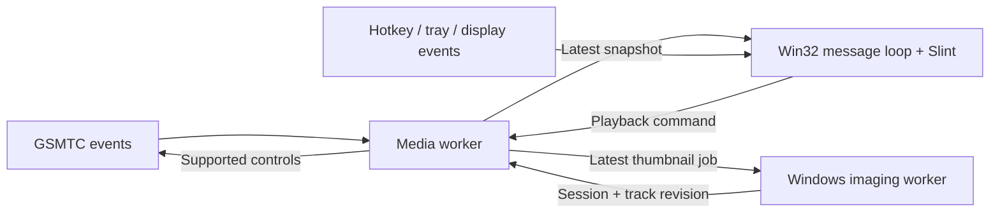

# Architecture

Media Flyout uses three application threads: the main Win32/Slint thread, a media
worker, and one artwork decoder. Windows also creates its own COM/WinRT thread-pool
threads. The application does not run an asynchronous runtime or a second GUI
framework.

## Media and artwork

The media worker initializes an MTA, requests the GSMTC manager, and subscribes to
session-list, current-session, playback, metadata, and timeline notifications.
Callbacks set atomic flags and send a coalesced wakeup through a bounded queue.
WinRT objects and subscription tokens stay with their owning worker. RAII removes
handlers, releases objects, and then uninitializes the apartment.

Windows can publish fresh wrapper objects for still-open sessions. Reconciliation
uses COM identity first, then unique source application IDs, then metadata for
applications with multiple sessions. Indistinguishable sessions use source-relative
order because GSMTC does not expose a public persistent session ID.

Automatic selection prefers a playing configured application, Windows' current
playing session, any playing session, the configured application, Windows' current
session, and finally the first available session. A valid manual selection takes
precedence. Application preferences are separate from temporary session IDs.

Display names are resolved on the media worker when sessions are discovered.
Known players have readable aliases; other sources use the Windows AppsFolder
display name before falling back to browser aliases or a readable executable ID.
This resolves installation-specific browser hashes without assigning them to a
particular website. Unresolved opaque IDs use a generic label. Snapshots carry
both the cached display name and the original ID; reconciliation and saved
preferences always use the original ID. Shell lookups never run during UI updates.

Metadata and controls have bounded asynchronous waits. Thumbnail references cross
apartments through `AgileReference`; they are resolved and decoded on a separate
worker with a single replaceable pending job and a three-second deadline. Results
carry a session ID and metadata revision. Late results from an old track are
discarded. Only the selected session retains decoded artwork, at most 256 × 256
RGBA pixels. Encoded images over 8 MiB, dimensions over 8192, and images over 16
million pixels are rejected before pixel transfer.

The UI mailbox retains only the latest snapshot and at most one queued UI
notification. Unchanged artwork is not converted to a new Slint image on playback
or timeline updates. Controls are checked again immediately before dispatch, since
a player can change its supported capabilities after the UI update.

## Window and rendering

The custom Slint `Platform` and `WindowAdapter` use one reusable Win32 `HWND`.
Slint rasterizes directly into a retained 32-bit BGR buffer through its public
`TargetPixel` API. GDI presents that buffer without a second pixel conversion.
`ReusedBuffer` enables Slint's partial rasterization; Windows clips the presentation
to the paint region. Software rendering is the only compiled renderer.

The event loop blocks in `GetMessage` when there is no work. It updates Slint's
monotonic clock after waking, before callbacks schedule timers. Slint timers use
the next required deadline, rather than a permanent frame timer. Hidden windows
are not painted. Short native alpha fades run only during transitions and honor
both configuration and Windows' client-area animation preference.

The tool window is topmost while visible, stays out of the taskbar, and uses
`WS_EX_NOACTIVATE` / `SW_SHOWNOACTIVATE`. Media buttons work without taking focus
from the foreground app. Work-area coordinates exclude taskbars, and margins and
dimensions scale with per-monitor DPI. DPI and display-change notifications
reposition the window; resume reconnects the media manager.

Escape and outside clicks use a 50 ms input check **only while visible**. This
keeps input hooks out of the process and preserves foreground focus. Very short
input can be missed. Progress uses a separate one-second display timer only when
visible and advancing. It extrapolates the last reported position using playback
rate and the provider's update timestamp, then clamps to the valid duration.
The progress bar previews pointer drags locally and sends one seek on release.
Seeks use absolute 100 ns ticks, clamp to the provider's seek range, and recheck
the player's capability on the media worker. Session IDs and metadata revisions
prevent a drag from seeking a different session or track. Dismissal pauses while
dragging and restarts on release. A status message appears below a valid timeline
so a rejected control or settings warning cannot hide progress or prevent a retry.
Empty provider timelines remain hidden; see the
[Gecko/YouTube investigation](gecko-youtube-progress.md).

## Configuration and lifecycle

The TOML parser accepts bounded files and validates every field independently.
The editor preserves comments, rereads the file before changing a preference, and
uses a synced temporary file plus atomic rename. Invalid TOML is never overwritten.
A failed reload keeps the last working settings.

Shortcut replacement registers a different native hotkey ID before dropping the
old registration. A conflict therefore preserves the working shortcut. A
session-local mutex prevents duplicate background instances; subsequent launches
send a show request to the original window. `--reload` and `--quit` use parameter-free
application messages. The notification icon is recreated after `TaskbarCreated`.

Exit hides the physical window immediately, stops UI timers, joins the media and
artwork workers, unregisters subscriptions and hotkeys, and removes the tray icon.
Native handles and unavoidable unsafe operations are isolated in the platform,
hotkey, and tray modules with their ownership assumptions documented.
